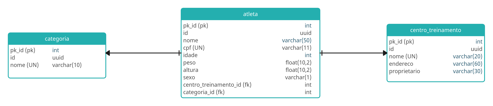

# FastAPI
### Quem é o FastAPi?
Framework FastAPI, alta performance, fácil de aprender, fácil de codar, pronto para produção.
FastAPI é um moderno e rápido (alta performance) framework web para construção de APIs com Python 3.6 ou superior, baseado nos type hints padrões do Python.

### Async
Código assíncrono apenas significa que a linguagem tem um jeito de dizer para o computador / programa que em certo ponto, ele terá que esperar por algo para finalizar em outro lugar

# Projeto
## WorkoutAPI

Esta é uma API de competição de crossfit chamada WorkoutAPI. É uma API pequena, devido a ser um projeto mais hands-on e simplificado nós desenvolveremos uma API de poucas tabelas, mas com o necessário para você aprender como utilizar o FastAPI.

## Desafio DIO - Bootcamp Luizalabs

Este repositório contém uma solução para o desafio do Bootcamp Luizalabs - Back-end com Python na DIO.<br>
<br>
Desafio de projeto: **Desenvolvendo sua Primeira API com FastAPI, Python e Docker**

## Modelagem de entidade e relacionamento - MER


## Stack da API

A API foi desenvolvida utilizando o `fastapi` (async), junto das seguintes libs: `alembic`, `SQLAlchemy`, `pydantic`. Para salvar os dados está sendo utilizando o `postgres`, por meio do `docker`.

## Execução da API

Para este projeto, utilizei o **[Poetry](https://python-poetry.org/)** para o gerenciamento de dependências e do ambiente virtual. O Poetry utiliza os arquivos `pyproject.toml` e `poetry.lock` para garantir que todas as dependências sejam instaladas corretamente.

Para configurar o ambiente e instalar as dependências, execute:

```bash
# Instala as dependências e cria o ambiente virtual
poetry install

# Ativa o ambiente virtual
poetry shell
```
Para subir o banco de dados, caso não tenha o [docker-compose](https://docs.docker.com/compose/install/linux/) instalado, faça a instalação e logo em seguida, execute:

```bash
make run-docker
```
Para criar uma migration nova, execute:

```bash
make create-migrations d="nome_da_migration"
```

Para criar o banco de dados, execute:

```bash
make run-migrations
```

## API

Para subir a API, execute:
```bash
make run
```
e acesse: http://127.0.0.1:8000/docs

# Desafio Final
    - adicionar query parameters nos endpoints
        - atleta
            - nome
            - cpf
    - customizar response de retorno de endpoints
        - get all
            - atleta
                - nome
                - centro_treinamento
                - categoria
    - Manipular exceção de integridade dos dados em cada módulo/tabela
        - sqlalchemy.exc.IntegrityError e devolver a seguinte mensagem: “Já existe um atleta cadastrado com o cpf: x”
        - status_code: 303
    - Adicionar paginação utilizando a lib: fastapi-pagination
        - limit e offset
# Referências

FastAPI: https://fastapi.tiangolo.com/

Pydantic: https://docs.pydantic.dev/latest/

SQLAlchemy: https://docs.sqlalchemy.org/en/20/

Alembic: https://alembic.sqlalchemy.org/en/latest/

Fastapi-pagination: https://uriyyo-fastapi-pagination.netlify.app/
